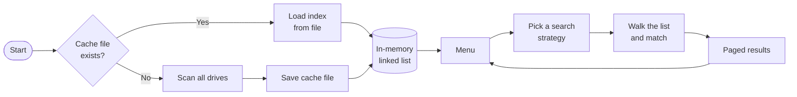

<div align="center">

# 🔎 QueryFS

### A blazing-fast, terminal-based file search engine written in modern C++


*Scan every drive once. Search millions of files in milliseconds.*

[Features](#-features) • [Quick Start](#-quick-start) • [How It Works](#-how-it-works) • [OOP Concepts](#-oop-concepts) • [Error Handling](#-error-handling)

</div>

---

## ✨ Features

| | Feature | Details |
|---|---|---|
| 💽 | **Auto-scans all drives** | Finds `C:\`, `D:\`, `E:\`… on Windows and `/` on Linux/macOS, with no setup |
| ⚡ | **Instant search** | The whole index lives in memory, so searches take milliseconds |
| 💾 | **Saved index** | After the first scan, the index is loaded from a cache file on every start |
| 🔤 | **Normal search** | Matches any file *or* folder whose name contains your text (case-insensitive) |
| 📄 | **Extension search** | Finds every `.pdf`, `.png`, `.cpp`… (the leading dot is optional) |
| 📁 | **Folder search** | Finds folders only |
| 🖥️ | **Clean terminal UI** | Screen clearing, paged results, live scan progress, tidy columns |
| 🛡️ | **Fault tolerant** | Locked folders, symlink loops and corrupt cache lines never crash it |
| 📦 | **Zero dependencies** | One `.cpp` file and the C++ standard library |

---

## 🚀 Quick Start

**Requirements:** any C++17 compiler (`g++`, `clang++`, MSVC).

```bash
# 1. Clone
git clone https://github.com/Vinayak-07/QueryFS.git
cd QueryFS

# 2. Build
g++ -std=c++17 -O2 QueryFS.cpp -o queryfs

# 3. Run
./queryfs            # Windows: .\queryfs.exe
```

> ⚠️ Use `-std=c++17` exactly. C++20 changes the return type of `path::u8string()` and breaks the build.

**Optional:** scan a single folder instead of all drives (handy for demos). This mode doesn't touch the cache.

```bash
./queryfs C:\Users\you\Documents
```

The **first run** scans everything and saves `queryfs_index.txt`. **Every later run** loads that file and starts instantly. Pick **Rescan** from the menu to refresh it.

---

## 🖼️ Demo

**Main menu**

```text
==============================================================
   QueryFS - File Search Engine
==============================================================
 Loaded 194265 items from saved index. Choose 4 to rescan.
 Indexed: 175553 files, 18712 folders
--------------------------------------------------------------
  1. Normal search   (name of any file or folder)
  2. Search by extension
  3. Search folders
  4. Rescan drives
  5. Exit
--------------------------------------------------------------
 Choose (1-5):
```

**Search results**

```text
==============================================================
   QueryFS - File Search Engine
==============================================================
 Search : name contains "report"
 Found  : 20 results in 0.00 ms
--------------------------------------------------------------
 pdf          3 B  /home/user/docs/report5.pdf
 pdf          3 B  /home/user/docs/report4.pdf
 pdf          3 B  /home/user/docs/report1.pdf
 ...
--------------------------------------------------------------
 Page 1 of 2   [Enter] next   [p] previous   [q] menu
 >
```

| Key | Action |
|---|---|
| `Enter` | Next page (on the last page, back to the menu) |
| `p` | Previous page |
| `q` | Back to the menu |

---

## ⚙️ How It Works



1. **Scan:** `Scanner` walks each drive recursively and adds every file and folder to a linked list.
2. **Store:** each `FileNode` keeps a pre-lowercased name, so a search is just a substring check with no extra work.
3. **Search:** the chosen strategy object decides which nodes match.
4. **Show:** results appear 15 at a time with size, type and path.

**Performance** (tested on Linux with ≈194,000 files and folders):

| Step | Time |
|---|---|
| Full scan (first run only) | ~3 s |
| Search | ~8 ms |

Times depend on your disk and how many files you have.

---

## 🧠 OOP Concepts

QueryFS uses all four pillars of object-oriented programming.

```mermaid
classDiagram
    direction LR
    class SearchStrategy {
        <<abstract>>
        +matches(FileNode) bool*
        +describe() string*
    }
    class NameSearch
    class ExtensionSearch
    class FolderSearch
    class FileList {
        -FileNode* head
        -FileNode* tail
        +add()
        +clear()
    }
    class FileNode {
        -string path
        -string nameLower
        -string ext
        -bool folder
        +getPath()
        +getExt()
        +isFolder()
    }
    class Scanner {
        -FileList& list
        +scan(root)
    }
    class IndexError

    SearchStrategy <|-- NameSearch
    SearchStrategy <|-- ExtensionSearch
    SearchStrategy <|-- FolderSearch
    FileList "1" *-- "many" FileNode
    Scanner --> FileList : fills
    IndexError --|> runtime_error
```



| Pillar | Where it is used |
|---|---|
| **Encapsulation** | `FileNode` and `FileList` keep every field `private`; the rest of the program uses getters |
| **Abstraction** | `SearchStrategy` is an abstract class. It declares *what* a search does (`matches`, `describe`) and leaves *how* to the child classes |
| **Inheritance** | `NameSearch`, `ExtensionSearch` and `FolderSearch` all inherit from `SearchStrategy` |
| **Polymorphism** | One `SearchStrategy` pointer holds any of the three searches, and virtual dispatch calls the right `matches()` at runtime |

**Also used:** constructors and destructors, `new`/`delete` ownership (the list frees every node itself), deleted copy operations, `override`, smart pointers (`unique_ptr`) and a custom exception class.

---

## 🛡️ Error Handling

| Situation | What QueryFS does |
|---|---|
| Folder is locked or access is denied | Skips it, keeps scanning, and reports the skipped count at the end |
| Symlink or Windows junction loop | Never follows links, so it can't loop forever |
| Empty CD drive or disconnected drive | Disk pop-ups are suppressed and the drive is skipped |
| No cache file on first run | Throws `IndexError`, catches it, and scans instead |
| Cache can't be written (disk full or read-only) | Shows a warning and keeps running |
| Damaged line in the cache file | Skips that line and loads the rest |
| Empty search text | Asks the user to type something |
| Invalid menu choice | Shows a message instead of crashing |
| Input stream closed (Ctrl+D / Ctrl+Z) | Exits cleanly |
| Anything unexpected, such as out of memory | Caught in `main` and reported with exit code 1 |

---

## 📁 Project Structure

```text
QueryFS/
├── QueryFS.cpp        # entire application: classes, scanner, UI
├── README.md
├── .gitignore
└── queryfs_index.txt  # auto-generated cache (not committed)
```

Inside `QueryFS.cpp`, the code runs in this order: helpers → terminal functions → `IndexError` → `FileNode` → `FileList` → `SearchStrategy` and its children → `Scanner` → cache I/O → search and display → `main`.

---

## 📝 Notes

- **Cache location:** `queryfs_index.txt` is created in whatever folder you run the program from. It lists every path on your drives, so keep it out of git. It is already in `.gitignore`.
- **Case-insensitive search:** works for English letters (A–Z). Non-English file names display correctly but match case-sensitively.
- **Linux/macOS:** `/proc`, `/sys` and `/dev` are skipped because they're virtual.

---

<div align="center">

### 👤 Author

**Vinayak** · B.Tech AI/ML · IICT, MGM University
Built for **Object-Oriented Programming (ITY23PCL203), CA-4**

[](https://github.com/Vinayak-07)

⭐ *If this helped you, drop a star!* ⭐

</div>
